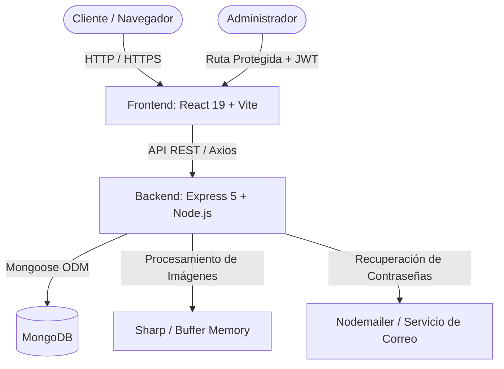

# DOCUMENTACIÓN TÉCNICA Y FUNCIONAL DEL PROYECTO ELECTRONOVA

**Coordinador del Proyecto:** Cristopher Silva Cruz  
**Líder del Proyecto:** Gutierres Vargas Lucila  
**Frontend Developer:** Silva Cruz Cristopher Stanley  
**Backend Developer:** Atalaya Abanto Erick Alexander  
**Sistema:** ELECTRONOVA — Plataforma Web de Catálogo y Gestión de Materiales Eléctricos  
**Versión:** 1.0.0  
**Fecha:** Octubre 2026  

---

## 1. INTRODUCCIÓN Y PROPÓSITO DEL PROYECTO

**ELECTRONOVA** es una solución web integral diseñada y desarrollada para la digitalización, exhibición comercial y administración de inventario de una empresa especializada en materiales, conductores y equipamiento eléctrico industrial y residencial.

El proyecto aborda dos frentes complementarios:
1. **Portal Público (Frontend Clientes):** Catálogo interactivo de alto rendimiento, filtrado por categorías, búsqueda en tiempo real, fichas técnicas detalladas de productos, visualización de precios y modo oscuro/claro integrado.
2. **Panel Administrativo Privado (Backoffice / Dashboard):** Módulo protegido con autenticación JWT para la gestión completa (CRUD) de productos, categorías, imágenes, especificaciones técnicas y métricas clave del negocio.

---

## 2. ARQUITECTURA TECNOLÓGICA GENERAL

La plataforma está construida bajo una arquitectura desacoplada basada en el stack **MERN / JavaScript Moderno (ES Modules)**:



### 2.1. Tecnologías del Backend
* **Entorno de Ejecución:** Node.js (con especificación `"type": "module"` para ESM nativo).
* **Framework Web:** Express.js v5.
* **Base de Datos:** MongoDB con **Mongoose v9** como ODM.
* **Seguridad y Criptografía:** 
  * `jsonwebtoken (JWT)` para la generación y validación de tokens de sesión y recuperación.
  * `bcrypt` para el cifrado y salteado seguro de contraseñas.
* **Gestión y Optimización Multimedia:**
  * `multer` para la recepción de archivos multipart/form-data en memoria (`memoryStorage`).
  * `sharp` para la compresión, redimensionamiento y codificación optimizada de imágenes en Base64.
* **Notificaciones:** `nodemailer` para el envío de correos de restablecimiento de contraseña.
* **Variables de Entorno y CORS:** `dotenv` y `cors` configurados con orígenes permitidos.

### 2.2. Tecnologías del Frontend
* **Biblioteca Principal:** React v19.
* **Herramienta de Construcción (Bundler):** Vite v8.
* **Enrutamiento:** React Router Dom v7.
* **Peticiones HTTP:** Axios v1.20 con interceptores de autorización.
* **Iconografía:** Lucide React.
* **Estilos y Diseño:** Vanilla CSS modular con variables CSS para soporte nativo de **Modo Claro / Modo Oscuro**.
* **Metodología de Componentes:** **Atomic Design** (Atoms, Molecules, Organisms, Templates, Pages).

---

## 3. DESGLOSE DETALLADO DEL BACKEND

La estructura interna del backend (`/backend/src`) sigue una arquitectura en capas por responsabilidades:

```
backend/src/
├── config/             # Configuración de base de datos MongoDB
├── controllers/        # Controladores HTTP (manejo de req, res y códigos de estado)
├── middlewares/        # Middlewares de autenticación (JWT) y subida (Multer)
├── models/             # Esquemas de datos Mongoose
├── routes/             # Definición de rutas y endpoints de la API
├── scripts/            # Scripts de automatización (seed de 100 productos y clear)
├── services/           # Lógica de negocio y consultas avanzadas
├── utils/              # Funciones auxiliares (Sharp, Nodemailer)
├── app.js              # Inicialización de middlewares y rutas globales
└── server.js           # Inicio del servidor HTTP y escucha de puerto
```

### 3.1. Modelos de Datos (`/models`)

1. **`Administrador.js`**:
   * Campos: `nombre`, `correo` (único), `contraseña`, `fechaRegistro`.
   * Seguridad: Middleware pre-guardado (`pre('save')`) que aplica hash mediante `bcrypt` solo cuando la contraseña es modificada. Método de instancia `comparePassword(candidata)`.
2. **`Categoria.js`**:
   * Campos: `nombre` (único), `descripcion`, `estado` (booleano), `idAdministrador`.
3. **`Producto.js`**:
   * Campos: `nombre`, `descripcionCorta`, `descripcionCompleta`, `precio`, `productoDestacado` (booleano), `especificacionesTec`, `caracteristicas`, `idCategoria` (ObjectId referenciado), `estado`, `fechaRegistro`, `fechaActualizacion`.
   * Propiedad virtual `imagenes` vinculada al modelo `Imagen` por `idProducto`.
4. **`Imagen.js`**:
   * Campos: `idProducto`, `tipo`, `ubicacion` (datos Base64 comprimidos o URL).
5. **`Empresa.js`**:
   * Campos: `nombre`, `descripcion`, `direccion`, `horarioAtencion`, `contacto`, `redesSociales`.

### 3.2. Capa de Servicios y Lógica de Negocio (`/services`)

* **`auth.service.js`**:
  * Autenticación con verificación de contraseña encriptada.
  * Emisión de token JWT con tiempo de expiración (24h).
  * Generación de token temporal de recuperación (15 min) firmado criptográficamente combinando la clave secreta y la contraseña actual del usuario.
  * Envío de plantilla HTML de recuperación vía email.
* **`productos.service.js`**:
  * **Paginación avanzada:** Cálculo dinámico de saltos (`skip`), límites (`limit`), total de páginas e indicadores de navegación. Soporte para visualización pública filtrada solo por productos activos (`estado: true`).
  * **Búsqueda multicampo:** Regex insensible a mayúsculas/minúsculas sobre `nombre`, `descripcionCorta` y `descripcionCompleta`.
  * **Filtrado por Categoría:** Filtro directo por `idCategoria` respetando paginación.
  * **Carga de imágenes en paralelo:** Procesamiento con Sharp a Base64 y asociación directa con el producto. Soporte de hasta 5 imágenes por producto.
  * **Actualización y Limpieza Atómica:** Reemplazo de imágenes existentes, eliminación física de imágenes descartadas y actualización de datos.
  * **Borrado en cascada:** Al borrar un producto, se eliminan automáticamente todos sus registros asociados en la colección `Imagen`.
* **`categorias.service.js`**:
  * Listado completo, creación y actualización de categorías.
  * **Validación de Integridad Referencial (RF-21):** Verificación previa de existencias con `Producto.countDocuments({ idCategoria: id })` impidiendo la eliminación si tiene productos asociados.
* **`empresa.service.js` y `usuarios.service.js`**:
  * Obtención de perfil del administrador y datos corporativos.

---

## 4. DESGLOSE DETALLADO DEL FRONTEND

El frontend (`/frontend/src`) fue diseñado implementando **Atomic Design**:

* **Atoms (Átomos):** `Boton.jsx`, `BotonCerrarModal.jsx`, `EtiquetaEstado.jsx`, `PrecioProducto.jsx`.
* **Molecules (Moléculas):** `TarjetaProducto.jsx`, `Paginacion.jsx`, `GaleriaProducto.jsx`, `SeccionDetalleProducto.jsx`.
* **Organisms (Organismos):** `Encabezado.jsx`, `PieDePagina.jsx`, `SeccionHero.jsx`, `ModalProductoDetalle.jsx`, `ModalFormularioProducto.jsx`, `ModalFormularioCategoria.jsx`, `TablaProductosAdmin.jsx` (con indicador visual de estado activo/inactivo), `TablaCategoriasAdmin.jsx`.
* **Templates (Plantillas):** `AdminLayout.jsx`, `RutaPrivada.jsx`.
* **Pages (Páginas):** `PaginaInicio.jsx`, `Productos.jsx`, `Nosotros.jsx`, `Contacto.jsx`, `Login.jsx`, `ForgotPassword.jsx`, `ResetPassword.jsx`, `DashboardAdmin.jsx`, `AdminProductos.jsx`, `AdminCategorias.jsx`.

---

## 5. CUMPLIMIENTO DE REQUERIMIENTOS

El sistema cumple rigurosamente con los 24 Requerimientos Funcionales (RF-01 al RF-24) y los 12 Requerimientos No Funcionales (RNF-01 al RNF-12) estipulados en la planificación oficial.

---

## RESUMEN GENERAL AL PIE: LO QUE SE HIZO EN ESTE PROYECTO

> ### 📌 Detalle General de las Acciones Realizadas en el Proyecto ELECTRONOVA
>
> 1. **Definición y Arquitectura del Negocio:** Se estructuró y modeló una plataforma web para la comercialización y administración de materiales eléctricos (**ELECTRONOVA S.A.C.**), cubriendo las necesidades tanto de clientes finales como del equipo administrativo.
> 2. **Desarrollo del Backend Completo:** Se creó una API REST escalable con Node.js y Express 5 bajo ES Modules, conectada a MongoDB mediante Mongoose. Se implementó autenticación con tokens JWT, encriptación de contraseñas con Bcrypt, recuperación de clave con token dinámico y envío de emails con Nodemailer, subida y compresión en memoria de hasta 5 imágenes por producto usando Multer y Sharp, validación de integridad referencial para evitar eliminación de categorías con productos (RF-21), borrado en cascada para imágenes y motores de búsqueda con paginación avanzada y filtro por disponibilidad/estado (RF-17).
> 3. **Sembrado Masivo de Catálogo Real:** Se desarrolló un script de población (`seed.js`) con 10 categorías formales del sector y 100 productos eléctricos reales con especificaciones técnicas detalladas y gráficos SVG vectoriales en Base64.
> 4. **Desarrollo del Frontend Modular con Atomic Design:** Se programó la interfaz en React 19 y Vite estructurada en Átomos, Moléculas, Organismos, Plantillas y Páginas, asegurando alta mantenibilidad y componentes reutilizables.
> 5. **Experiencia de Usuario (UI/UX) Moderna:** Se incorporó cambio de Tema Claro / Oscuro con Vanilla CSS, catálogo con filtros reactivos y paginación, modales rápidos para fichas técnicas sin recarga y un componente `ErrorBoundary` para estabilidad.
> 6. **Panel de Control Administrativo (Backoffice):** Se implementó un panel protegido por guardianes de ruta (`RutaPrivada`) con dashboard de métricas y mantenimiento completo (CRUD) de productos y categorías con carga de imágenes, edición en modales y visualización de estados en tiempo real.
> 7. **Orquestación y Despliegue Local:** Se unificó la ejecución del proyecto mediante variables de entorno y scripts de ejecución concurrente para desarrollo ágil en un solo comando (`npm run dev`).
>
> ---
> **Roles del Equipo:**  
> - **Líder del Proyecto:** Gutierres Vargas Lucila  
> - **Frontend Developer:** Silva Cruz Cristopher Stanley  
> - **Backend Developer:** Atalaya Abanto Erick Alexander  
> **Coordinador General del Proyecto:** Cristopher Silva Cruz  
> **Estado:** Proyecto documentado y 100% alineado con todos los requerimientos funcionales (RF-01 al RF-24) y no funcionales (RNF-01 al RNF-12).
